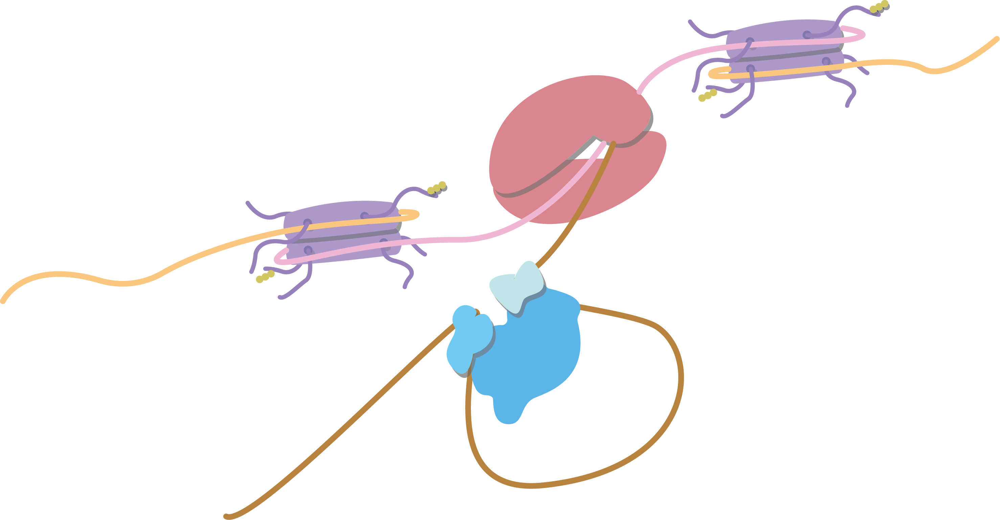

## Intron Biology

Introns are non-coding sequences within genes that are transcribed into RNA but are spliced out before translation into protein. Despite introns being ubiquitous features of eukaryotic genomes, their function and persistence in genomes remain elusive. My research aims to unravel the role of introns in chromatin structure and explore how their architecture and sequences influence transcriptional regulation.

### Predicting Chromatin Features from Intron Architecture

To understand the relationship between intron architecture and chromatin features in the model plant *Arabidopsis thaliana*, we predicted histone modifications, histone variants, DNA methylation, and gene expression patterns from gene features. Our analysis revealed that first intron position is predictive of active chromatin marks enriched near transcription start sites, while intron number correlates with distinct chromatin marks found in gene bodies of broadly expressed genes.

Notably, we identified enrichment of the gene body mark H3K36me3 within introns, a pattern that appears to be plant-specific. To validate these associations, we compared recently duplicated gene pairs with divergent intron architectures and confirmed that intron number is positively associated with H3K4me1, H3K36me3, H2A.X, meCG methylation, and broad expression across tissues.

  
  &nbsp;&nbsp;
  

  <a class="explore-btn" href="/metaplots" target="_blank">
    📊
    Explore the distribution of chromatin features binned by gene architecture interactively
  </a>
  &nbsp;
  <a class="explore-btn" href="/scatterplots" target="_blank">
    📊
    Explore the relationship between gene features and chromatin features interactively
  </a>

  
  

    <h3 class="pkg-name">intronology R Package</h3>
    
An R package for annotating intron architecture across genomes

    <a href="https://github.com/AlicePierce/intronology" target="_blank" class="explore-btn" style="margin-top:0;">
      📦 View on GitHub
    </a>
  

## Publications

Intron architecture predicts chromatin features in <em>Arabidopsis thaliana</em>

<strong>Alice Pierce</strong>, Alan Rose, Grey Monroe (2025)
bioRxiv
<a class="doi-link" href="https://doi.org/10.1101/2025.10.15.682614">DOI</a>

Evolutionary Trajectories of Cohesin Gatekeepers across the Tree of Life

Daniela Quiroz, <strong>Alice Pierce</strong>, Grey Monroe (2025)
bioRxiv
<a class="doi-link" href="https://doi.org/10.1101/2025.05.08.652912">DOI</a>

Convergent Evolution of Epigenome Recruited DNA Repair across the Tree of Life

J. Grey Monroe, Chaehee Lee, (…), <strong>Alice Pierce</strong>, et al. (2025)
eLife
<a class="doi-link" href="https://doi.org/10.7554/eLife.105016.1">DOI</a>

H3K4me1 recruits DNA repair in plants

Daniela Quiroz, Diego Lopez-Mateos, Kehan Zhao, <strong>Alice Pierce</strong>, et al. (2024)
The Plant Cell
<a class="doi-link" href="https://doi.org/10.1093/plcell/koae089">DOI</a>

Celebrating Plant Diversity through Art

<strong>Alice Pierce</strong>, Ian Anderson, Neelima Sinha and Grey Monroe (2023)
Plant Science Bulletin
<a class="doi-link" href="https://botany.org/psbarchive/issue/2023-v69-3.html">Link</a>

The Farm-to-Fork Journey: Keeping Produce Fresh and Safe to Eat

<strong>Alice Pierce</strong>, Joseph Student and Maeli Melotto (2022)
Frontiers for Young Minds
<a class="doi-link" href="https://doi.org/10.3389/frym.2022.587135">DOI</a>

Spatiotemporal regulation of JAZ4 expression and splicing contribute to ethylene- and auxin-mediated responses in <em>Arabidopsis</em> roots

Logan DeMott, Paula Oblessuc, <strong>Alice Pierce</strong>, Joseph Student and Maeli Melotto (2021)
Plant Journal
<a class="doi-link" href="https://doi.org/10.1111/tpj.15508">DOI</a>

